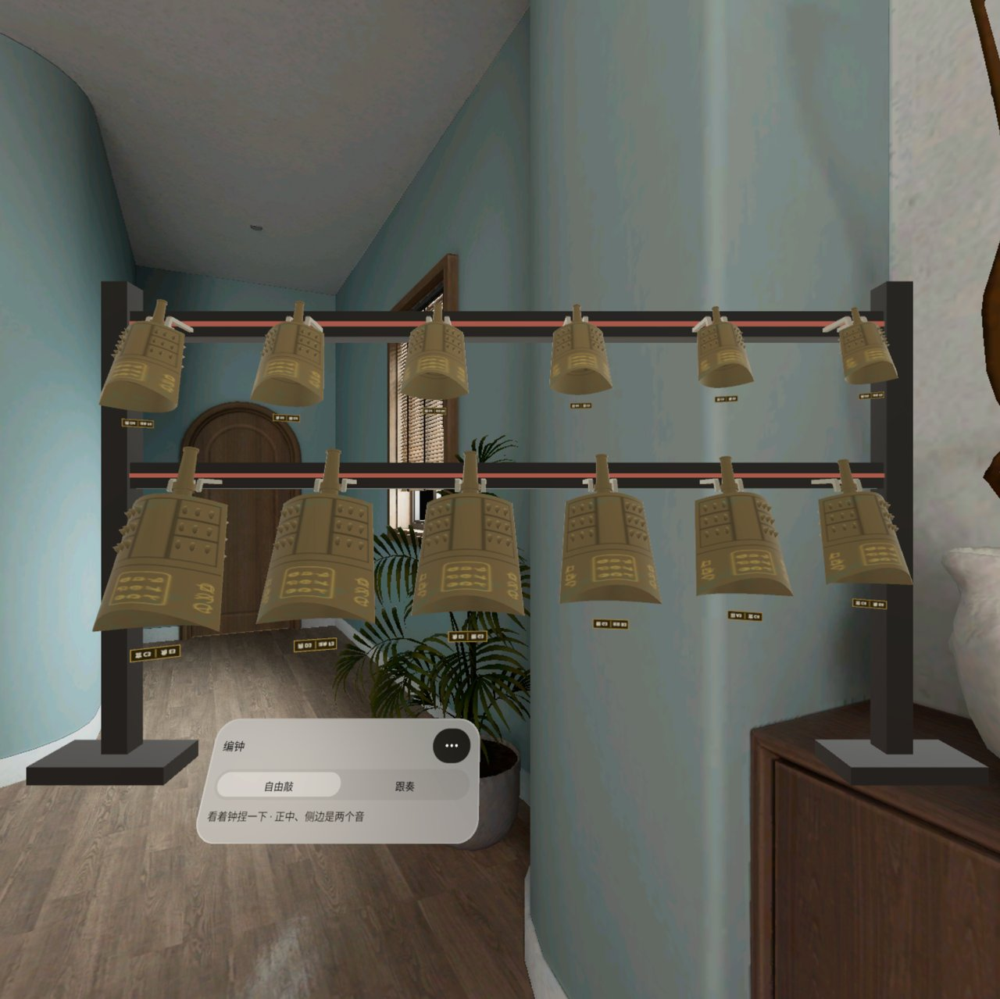
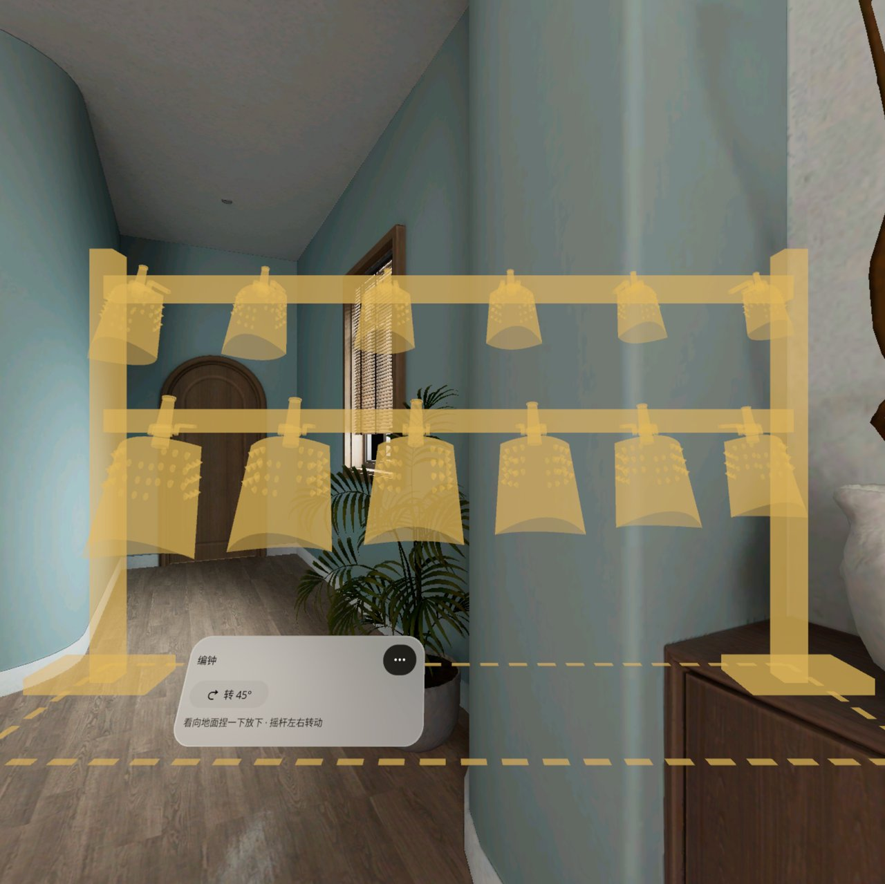
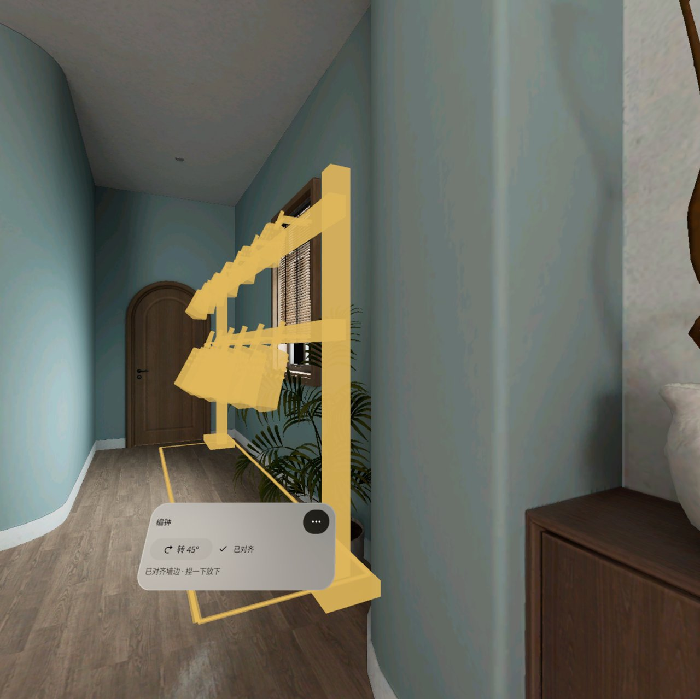
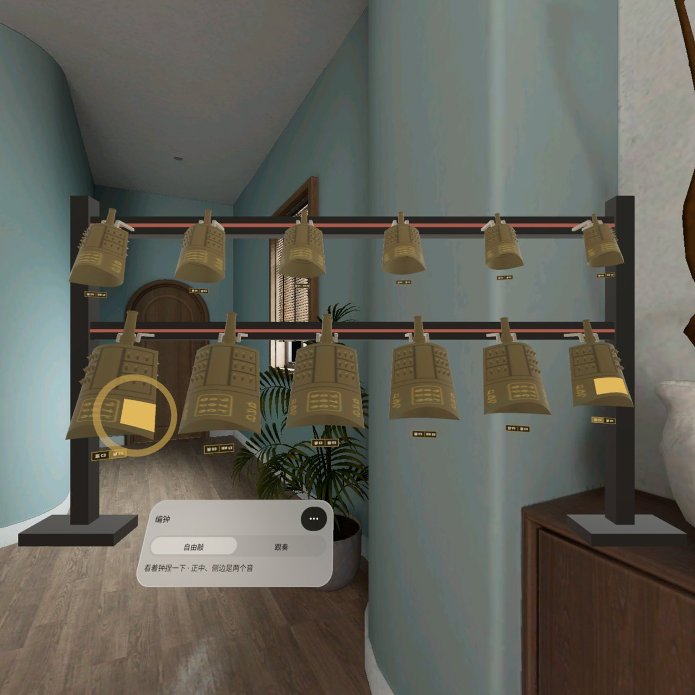
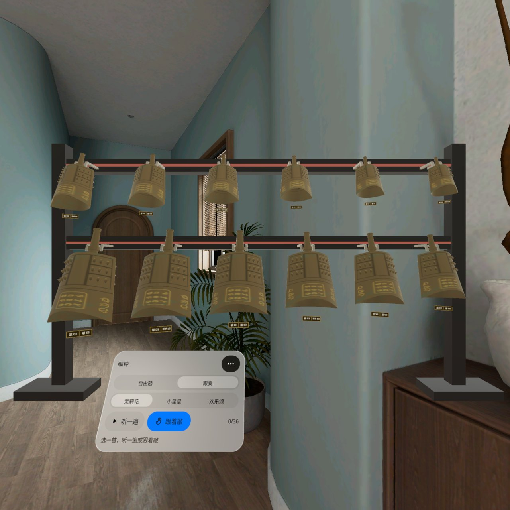
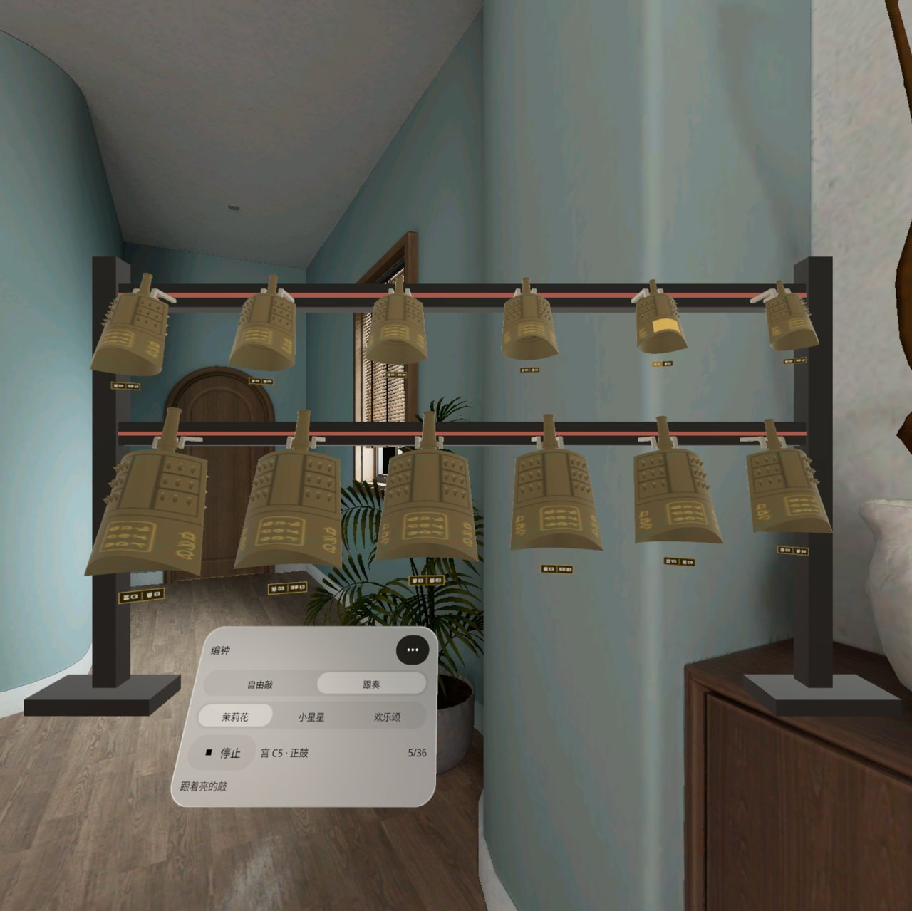
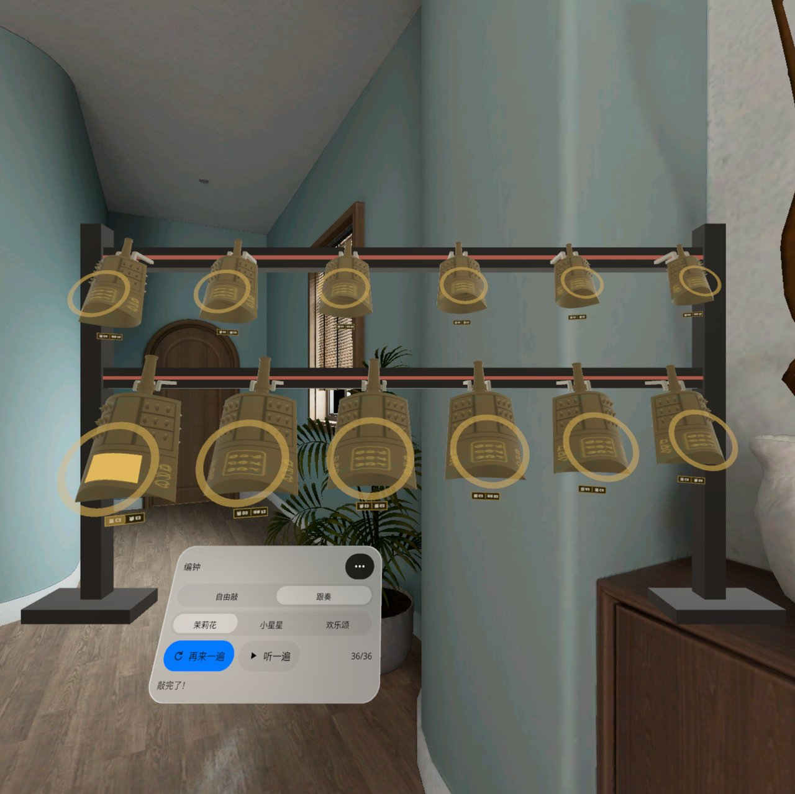
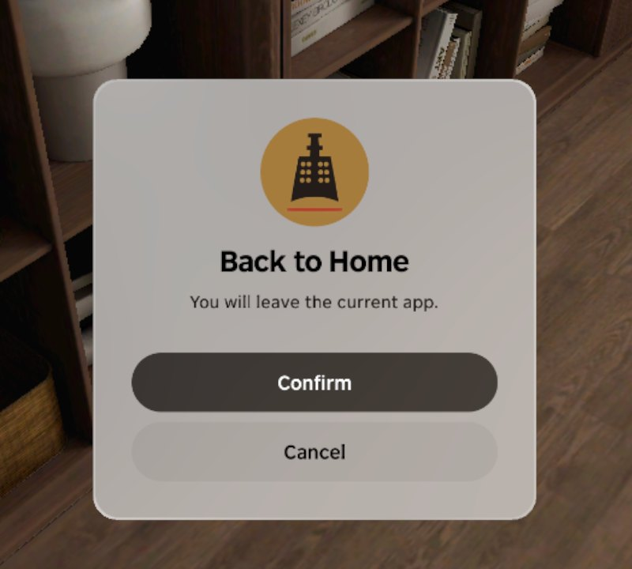

<p align="center"></p>

# Chime Bells | 编钟

**一组 12 口曾侯乙式甬钟按 1:1 挂在你家墙边：看着钟捏一下就响，敲正中一个音、敲侧边另一个音（一钟双音）；切到「跟奏」，跟着亮起来的鼓面能敲完一段《茉莉花》。**

**Twelve Zeng-Hou-Yi-style bronze bells hang life-size on a two-tier rack beside your real wall. Look at a bell and pinch: strike the centre for one note and the side for another (one bell, two notes). In Follow mode the next drum lights up so you can play a whole tune.**

PICO OS 6 · PICO Spatial SDK 6.1.9 · Kotlin / SpatialUI · package `io.embodit.bianzhong` · v0.1.4

> **模拟器 QA 通过，真机未验证（Simulator-QA passed; not yet verified on a real headset）。**



> 截图和演示视频来自原生模拟器（PICO Emulator 6.1），由调试广播和模拟器鼠标（= 视线 + 捏合）驱动；**非真实手势录像**，演示视频无声。
> Screenshots and the demo video were taken on the native PICO emulator, driven by debug broadcasts and the emulator mouse (standing in for gaze + pinch); **not a recording of real hand gestures**; the demo video has no sound.
>
> 钟声为模态合成（每个音 6 个衰减分音，按合瓦形钟的双峰做了拍音），不是录音采样。
> The bell sounds are modal synthesis (six decaying partials per stroke, with twin partials for the almond-shaped bell's beating), not recorded samples.

---

## 中文

### 这是什么

看着地面捏一下，一座 3.8 米长、两层一字的漆木钟架就落在你家地板上：下层 6 口大钟、上层 6 口小钟，低音在左。转头看向一面够长的墙，地上会出现贴墙的虚线框，钟架靠近就自动吸附对齐（位置和朝向），捏一下放下；也可以按「转 45°」或推摇杆转动。

每口钟都是一钟双音：敲正鼓（正中）一个音，敲侧鼓（侧边）另一个音，相差一个三度，铭牌上写着两个音名。被敲的钟会轻轻摆动、鼓面泛起涟漪，左边的钟声音偏左、右边的偏右。切到「跟奏」，选《茉莉花》《小星星》或《欢乐颂》，可以先「听一遍」，再「跟着敲」：下一个要敲的鼓面会亮起来，敲对才往下走，敲完 12 口钟一起泛起金色涟漪。更多菜单里能隐藏音名、换语言、把钟架缩到 1:2、重新摆放。中英双语，不联网。

### 安装与启动

```bash
adb install -r ChimeBells-v0.1.4.apk
pico-cli app launch io.embodit.bianzhong
```

APK 在 [Releases](https://github.com/kejing-dev/ChimeBells/releases) 页面下载（仓库不含 APK）。需要 PICO OS 6 头显或 PICO Emulator 6.1；用到地面 / 墙面平面识别。APK 约 41 MB（含 24 段钟声）。钟架 1:1 需要约 3.8 × 0.9 米的空地；房间小可以在更多菜单里缩到 1:2。

### 版本

- **v0.1.4**：默认音量更响（比 v0.1.3 约高 8 dB），连续快敲不再越敲越小；「更多 › 音量」改成可拖动滑条，吸附低 / 中 / 高三档。只在头显上试过，没有跑模拟器 QA。
- v0.1.3：钟架放好就锁定，按主面板「移动」才能挪；主面板固定在房间里，可拖动、可叫回，不跟头。
- v0.1.2：修好退后台再回来钟架跑到身后；找不到地面时用虚拟地面；加静音和音量。
- v0.1.1：重新摆放 / 回正视角后，钟架按头显当前的位置和朝向出现在正前方 2.5 m、正面朝你，不会再跑到身后（之前幽灵钟架跟着手柄射线走，手柄放着不动、射线朝后时会落到背后）；钟下的音名牌不再上下颠倒；控制面板 / 跟奏面板不再挡住左下几口钟的音名牌和鼓面；提示对话框放到视线略下方。
- v0.1.0：首个版本。

### 容器与骨架

- **容器**：只有 Full Space · `STAGE_MIXED`（透视），没有 Shared Space 版本。钟架要 1:1 落在真实地板上、吸附到真实墙边，依赖地面 / 墙面平面识别，只在 Full Space 可用。
- **骨架 D**（同机器人工位 Robot Cell Fit / 火情预案 Fire Plan / 空间尺 Spatial Ruler）：平面识别、懒跟随面板、预建面板池、每帧系统（幽灵钟架、吸附、摇杆、摆动、涟漪、悬停射线、声像）。钟和钟架由代码程序生成（合瓦形钟体、甬、旋、36 枚、青铜材质和运行时画的篆带铭文）；开场一次只建一口钟，避免主线程卡住。钟声由 `tools/synth_bells.py` 离线合成 24 段，运行时用 SoundPool 播放。
- **状态**：设计包 19 个状态（S0–S18），全部可由调试广播直接跳转并截图，结构见 [AGENTS.md](AGENTS.md)。

### 截图

| | |
|---|---|
|  |  |
| 摆放 — 幽灵钟架跟着视线走，「转 45°」 | 吸附 — 靠近墙边虚线框变实线「已对齐」 |
|  |  |
| 敲响 — 侧鼓亮一块，泛起涟漪 | 选曲 — 听一遍 / 跟着敲 |
|  |  |
| 跟奏 —「宫 C5 · 正鼓」亮起，5/36 | 敲完了 — 12 口钟一起泛起涟漪，36/36 |

启动器图标：



### 已知问题（QA 第 1 轮，不影响使用）

- 空闲模拟器上开场约 20–40 秒「正在准备」才出钟架：为防启动卡死改成一次只建一口钟，空闲模拟器每步隔 0.6 秒；真机上每帧一步，约 1 秒，快得多。
- 英文界面的提示行被截断（「…centre and side are two …」后半句看不到）。
- 摆放时捏在墙上也会放下钟架（位置照幽灵来，幽灵一直在地上，位置是对的）。
- 截图里偶尔有一口钟发白：那是模拟器鼠标位置的系统悬停高光，不是应用画的。

还没在头显上验过：真钟声好不好听和左右声像、手柄摇杆转钟架、真捏合敲钟的手感（尤其上层小钟）、真实墙面吸附、青铜在真房间光下的样子、空间权限。手柄震动本版没做。

---

## English

### What it is

Look at the floor and pinch, and a 3.8 m two-tier lacquer rack lands on your floor: six large bells below, six small ones above, low notes on the left. Turn towards a long enough wall and dashed outlines appear along it; bring the rack close and it snaps into line (position and heading), then pinch to place. You can also turn it with [Turn 45] or the thumbstick.

Every bell has two notes: strike the front drum (centre) for one, the side drum for the other, a third apart; the plate under each bell names both. A struck bell swings a little and ripples spread on the face you hit; bells on the left sound from the left and those on the right from the right. In Follow, pick Jasmine Flower, Twinkle Twinkle or Ode to Joy, listen once, then play along: the next drum lights up and only the right strike moves on; at the end all twelve bells ripple in gold. The More menu hides note names, switches language, shrinks the rack to 1:2 and moves it. Chinese and English, offline.

### Install and launch

```bash
adb install -r ChimeBells-v0.1.4.apk
pico-cli app launch io.embodit.bianzhong
```

Download the APK from the [Releases](https://github.com/kejing-dev/ChimeBells/releases) page (the repository itself does not ship an APK). Needs a PICO OS 6 headset or PICO Emulator 6.1; uses floor / wall plane detection. The APK is about 41 MB (24 bell strokes included). The 1:1 rack needs about 3.8 × 0.9 m of clear floor; in a small room shrink it to 1:2 from the More menu.

### Versions

- **v0.1.4**: louder by default (about 8 dB over v0.1.3), fast runs no longer fade; More > Volume is now a slider that snaps to low / medium / high. Tried on the headset only, no emulator QA.
- v0.1.3: the placed rack stays locked until you press Move on the main panel; the main panel stays fixed in the room, can be dragged and recalled, and no longer follows your head.
- v0.1.2: fixed the rack ending up behind you after returning from the background; virtual floor when no floor is found; mute and volume.
- v0.1.1: after "Move rack" or a recenter the rack appears 2.5 m straight ahead of where the headset is facing, its front to you, never behind (0.1.0 let the ghost follow the controller ray, which on the headset could point backwards while the controller lay still); the note plates under the bells are no longer upside down; the control / Follow panel no longer covers the lower-left bells' plates and drums; dialogs sit slightly below eye level.
- v0.1.0: first build.

### Container and skeleton

- **Container**: Full Space only, `STAGE_MIXED` (passthrough); no Shared Space version. The rack stands life-size on the real floor and snaps to real walls, which needs floor / wall plane detection — Full Space only.
- **Skeleton D** (same as Robot Cell Fit / Fire Plan / Spatial Ruler): plane detection, lazy-follow panel, pooled panels, a per-frame system (ghost rack, snapping, thumbstick, swings, ripples, hover ray, panning). Bells and rack are generated in code (almond-section body, shank, collar, 36 bosses, bronze material with run-time inscription bands); at startup one bell is built per step so the main thread never stalls. The 24 strokes are synthesised offline by `tools/synth_bells.py` and played with SoundPool.
- **States**: 19 designed states (S0–S18), each reachable by a debug broadcast and captured; see [AGENTS.md](AGENTS.md).

### Screenshots

See the table above: placing the ghost rack, snapping to the wall, a strike with ripples, picking a song, Follow mode, and the finished tune.

### Known issues (QA round 1, none blocking)

- On an idle emulator the rack takes about 20–40 s of "Preparing" to appear: startup builds one bell per step to avoid a stall, and the idle emulator waits 0.6 s per step. On a headset it is one step per frame, about 1 s.
- In English the hint line is cut off ("…centre and side are two …").
- While placing, pinching on a wall also places the rack (at the ghost, which always stays on the floor, so the position is right).
- One bell sometimes looks pale in screenshots: that is the system hover highlight under the emulator mouse, not drawn by the app.

Not yet verified on a headset: how the bells sound and pan, thumbstick rotation, the feel of pinching bells (especially the small upper ones), snapping to real walls, the bronze under real room light, and the spatial permission. Controller vibration is not in this version.

---

## License

Source code © 2026 Embodit. All rights reserved (private repository). Bundled fonts Noto Sans / Noto Sans SC (subset) are under the SIL Open Font License, see `third_party/`. Bell sounds are synthesised by `tools/synth_bells.py`; no recorded samples.
